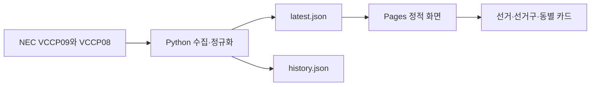

# 분당구 개표 흐름 대시보드

중앙선거관리위원회 선거통계시스템의 개표율과 투표 구분별 결과를 결합해 보여주는 정적 대시보드입니다. 현재 공개 화면은 2026년 6월 4일에 고정한 과거 선거 스냅샷을 제공합니다.

## 해결하려는 문제

개표율과 관내사전·선거일·관외사전·거소투표 결과는 서로 다른 보고서에 나뉘어 있습니다. 이 프로젝트는 `VCCP09`의 진행 상황과 `VCCP08`의 개표단위별 결과를 수집해 선거·선거구·동별 카드로 정리합니다. 투표 종류별로 결과가 반영됐는지와 후보별 득표를 함께 확인할 수 있습니다.

## 주요 기능

- 분당구 도·시의원 선거구별 개표 현황과 후보 득표 표시
- 경기도지사·성남시장·비례대표·교육감 결과와 지역별 상세 표시
- 해당 선거의 국회의원 선거구 자동 탐색 및 지역별 결과 표시
- 투표 종류별 반영·대기·상세없음 구분과 득표 막대
- 선거구·동별 상세 접기/펼치기 및 데이터 갱신 시 펼침 상태 복원
- 클라이언트의 당선 표시·비례 의석 계산 로직

당선·의석 표시는 [화면 코드](public/app.js)의 계산 결과입니다. 공식 확정 판정이나 모든 예외를 검증한 결과로 사용하면 안 됩니다.

## 실제 화면과 데모

[공개 대시보드](https://leesemi-camp.github.io/bundang-count/)에서 선거 카드를 펼치고 선거구·동별 투표 종류와 후보 득표를 확인할 수 있습니다. 2026-11-13 Chrome에서 저장 데이터의 렌더링을 확인했습니다.

현재 [latest.json](public/data/latest.json)의 생성시각은 `2026-06-04T12:15:08+09:00`입니다. 브라우저가 주기적으로 파일을 확인하더라도 원본 파일이 갱신되지 않으면 표시 내용은 바뀌지 않습니다.

## 기술 스택

| 영역 | 사용 기술 |
|---|---|
| 데이터 수집 | Python 표준 라이브러리: urllib, HTMLParser, dataclasses, json |
| 화면 | HTML, CSS, JavaScript, Intl, details/summary |
| 저장 | latest.json, history.json |
| 배포 | GitHub Pages, GitHub Actions |

별도 API 서버나 데이터베이스는 없습니다. 브라우저는 수집된 JSON을 읽습니다.

## 구조와 주요 설계



**수집과 열람을 분리했습니다.** [fetch_nec.py](scripts/fetch_nec.py)는 HTML 보고서를 파싱하고 투표 구분을 정규화해 JSON을 생성합니다. [app.js](public/app.js)는 60초마다 `latest.json`을 확인하며 `generatedAt`이 바뀔 때만 화면을 다시 그립니다. `history.json`은 수집 이력 보관용이고 현재 화면에서 읽지 않습니다.

**보고서의 의미 차이를 유지합니다.** 진행률은 VCCP09, 투표 종류별 세부 결과는 VCCP08에서 가져옵니다. VCCP08의 선거인수를 전체 선거인수와 동일하게 취급하지 않도록 데이터에 설명을 남깁니다. 일부 수집 실패는 scope별 오류와 `errorCount`로 기록하므로 프로세스 종료 코드만으로 완전 수집을 판단하지 않습니다.

**표시 상태를 데이터와 구분합니다.** 데이터가 바뀌어 카드를 다시 만들 때 기존 접기/펼치기 상태를 복원합니다. 세부 결과가 없는 경우는 0표 확정과 구분해 `상세없음`으로 표시합니다.

## 설치와 실행

기존 스냅샷을 열어보는 데는 재수집이 필요하지 않습니다. Python 3을 준비합니다.

```bash
git clone https://github.com/leesemi-camp/bundang-count.git
cd bundang-count
python3 -m http.server 5173 --bind 127.0.0.1 --directory public
```

`http://127.0.0.1:5173/`에서 확인합니다. 화면 글꼴은 외부 CDN을 사용합니다.

### 수집 코드 확인

수집 대상 선거 ID는 `scripts/fetch_nec.py`의 `0020260603`으로 고정되어 있습니다. 재수집 시 NEC의 현재 응답에 따라 결과가 달라질 수 있으므로, 기존 스냅샷을 보존하려면 별도 출력 경로를 지정하세요.

```bash
python3 scripts/fetch_nec.py --help
python3 scripts/fetch_nec.py \
  --output /tmp/bundang-latest.json \
  --history /tmp/bundang-history.json
```

수집 코드는 외부 Python 패키지를 요구하지 않습니다. [local_updater.sh](scripts/local_updater.sh)는 기본 90초 대기 후 수집을 반복하고 데이터 커밋·`main` push까지 수행하는 운영 스크립트입니다. 단순 열람이나 안전한 재수집 확인용 명령으로 사용하지 마세요. 실제 주기는 수집 시간과 대기 시간을 합한 값입니다.

## 배포

[Pages workflow](.github/workflows/pages.yml)는 `main` push와 수동 실행 시 `public/`을 배포합니다. 현재 workflow에는 정기 수집 cron이나 Python 수집 단계가 없습니다. 저장소의 Pages source는 GitHub Actions로 설정합니다.

## 테스트와 검증

전용 자동 회귀 테스트는 없습니다. 네트워크 요청과 파일 덮어쓰기 없이 문법·저장 데이터를 확인할 수 있습니다.

```bash
node --check public/app.js
bash -n scripts/local_updater.sh
python3 - <<'PY'
import ast
import json
from pathlib import Path
ast.parse(Path('scripts/fetch_nec.py').read_text(encoding='utf-8'))
latest = json.loads(Path('public/data/latest.json').read_text(encoding='utf-8'))
history = json.loads(Path('public/data/history.json').read_text(encoding='utf-8'))
assert isinstance(latest['scopes'], list) and latest['scopes']
assert isinstance(history['snapshots'], list)
print(latest['generatedAt'], latest.get('errorCount'))
PY
```

2026-11-13 위 검사와 공개 화면 렌더링을 확인했습니다. NEC 재수집, 파서 회귀 테스트, 당선·의석 계산의 모든 경우와 공식 수치 대조는 수행하지 않았습니다.

## 현재 상태와 알려진 한계

- 현재 데이터는 과거 스냅샷입니다. 지속 수집 중인 실시간 서비스가 아닙니다.
- 수집기는 NEC의 HTML 구조·선거 코드·네트워크에 의존합니다. 다른 선거에 그대로 적용할 수 있다고 보장하지 않습니다.
- `history.json`을 이용한 시계열 차트는 구현되어 있지 않습니다.
- 당선 표시와 비례 의석 추정은 화면의 계산 로직이며 원문을 확인해야 합니다.
- HTML 하단에는 수집 주기 120초라는 과거 문구가 남아 있습니다. 실제 업데이터 기본 대기는 90초이고, 공개 스냅샷이 자동 갱신 중이라는 뜻은 아닙니다.
- 저장소에 별도 LICENSE 파일은 없습니다.

## 관련 링크

- [중앙선거관리위원회 선거통계시스템](https://info.nec.go.kr/)
- [수집·파싱·집계 코드](scripts/fetch_nec.py)
- [화면 렌더링과 계산 코드](public/app.js)
- [저장 데이터](public/data/)

자료 출처는 중앙선거관리위원회 선거통계시스템입니다.
